<div align="center">


# SlothSpend

**Slow and steady subscription audits — on your own computer.**

Find the subscriptions you forgot, the prices that crept up and the charges that came twice,
with open models (Gemma + TabPFN) running locally. SlothSpend **informs, never acts**.

%20%7C%20Windows%20x64-0b051d)


[Website](https://slothspend.tech) · [Download](https://github.com/souptik4572/sloth-spend/releases/latest) ·
[How it works](#how-it-works) · [Privacy](#privacy-where-your-data-goes) · [Develop](#development)

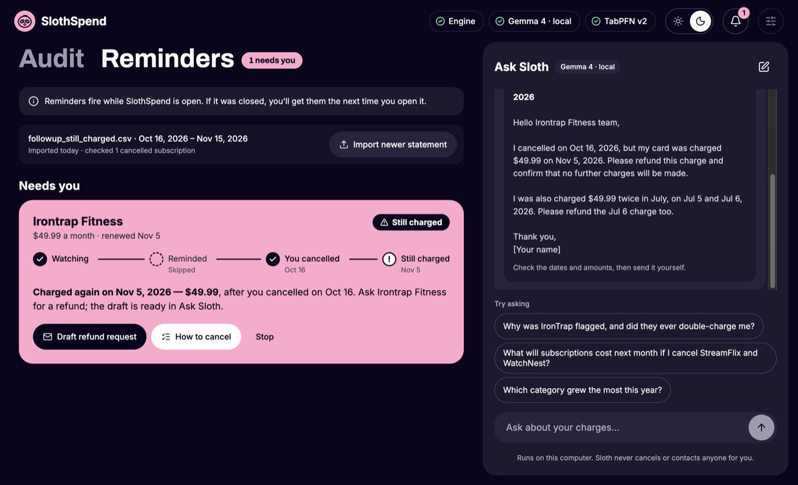

</div>

---

## Contents

- [Why SlothSpend](#why-slothspend)
- [Features](#features)
- [How it works](#how-it-works)
- [Screenshots](#screenshots)
- [Install](#install)
- [First run](#first-run)
- [Using SlothSpend](#using-slothspend)
- [Privacy: where your data goes](#privacy-where-your-data-goes)
- [Architecture](#architecture)
- [Performance](#performance)
- [Development](#development)
- [Configuration](#configuration)
- [Engine API](#engine-api)
- [Troubleshooting](#troubleshooting)
- [Roadmap](#roadmap)
- [Hacktoberfest notes](#hacktoberfest-notes)
- [License and attribution](#license-and-attribution)

## Why SlothSpend

A year of bank transactions says where you live, what you eat and who you love. Cloud "subscription
trackers" want that data — and often a login to your bank. SlothSpend takes a CSV export, keeps it in a local
database, and runs every model on your own machine. After a one-time model download it makes **no network
calls at all**.

The theme is *slow and steady*: the sloth never rushes and never acts for you. It waits for the right
moment to remind you, retries patiently when the local model is busy, and checks your next statement before
declaring victory.

### Inform, never act

- It **never** cancels a subscription, logs in anywhere, or contacts a merchant. It drafts; you send.
- It **never** invents a link or a phone number — answers and drafts are checked and scrubbed.
- It **never** claims to have done something it didn't. If the model says "I've set a reminder" and no
  tool confirmed it, the answer is replaced with what actually happened.
- Every number shows which model produced it: *Gemma 4 · local*, *TabPFN v2*, or a labelled *Template* /
  *Heuristic* fallback when a model isn't available.

## Features

| | |
|---|---|
| **Statement import** | Any bank CSV: auto-detects header rows, date order, debit/credit columns, currency (USD, INR, EUR, GBP) and Indian digit grouping; a column mapper for the rest. Newer statements append. |
| **Merchant cleanup** | Gemma turns `ACH DEBIT IRONTRAP FITNESS MEMB 7731` into *IronTrap Fitness* with a category, in priority order under a time budget; your renames always win. |
| **Recurring detection** | TabPFN v2 (a tabular foundation model) scores each merchant series in context; "Not a subscription" re-scores in ~2 s. |
| **Forecast with a range** | Next-charge q10–q90 quantiles and a 30-day spend forecast, not a single guess. |
| **Flags** | Double charges, price creep, overlapping services, possible annual plans, zombie suspects — each with a plain-language reason. |
| **Ask Sloth** | A local chat agent with 8 typed tools, including a *live* TabPFN what-if forecast. Every tool call is shown. |
| **Drafts** | Cancellation, refund and negotiation emails written from your own charge history — checked for exact facts, no links or phone numbers. |
| **Reminders** | Before a renewal, a desktop notification (or on next launch). Keep, snooze (max 3), or cancel yourself. |
| **Verification** | After "I cancelled it", the next statement confirms the charge stopped — or flags it as still charged with a refund request ready. |
| **Settings & privacy** | Theme, chat model, currency, reminder timing, demo mode, opt-in traces, an egress table, and *Delete all local data*. |

## How it works

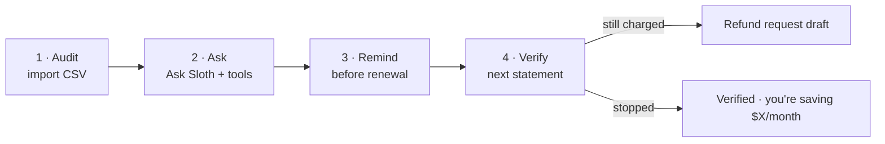

1. **Audit** — the engine parses the CSV, Gemma normalises merchants, deterministic detectors find double
   charges, TabPFN scores which series recur and forecasts the next charge, and detectors flag price creep,
   overlaps and possible annual plans. Gemma rephrases a code-written summary (and must keep every number).
2. **Ask** — Ask Sloth answers in plain language using typed tools, and drafts emails on request.
3. **Remind** — a reminder N days before renewal (default 3). It fires while SlothSpend is open, or on the
   first tick after you next open it.
4. **Verify** — after you cancel (yourself), importing a newer statement checks for a charge after your
   cancellation date.

## Screenshots

| | |
|---|---|
| 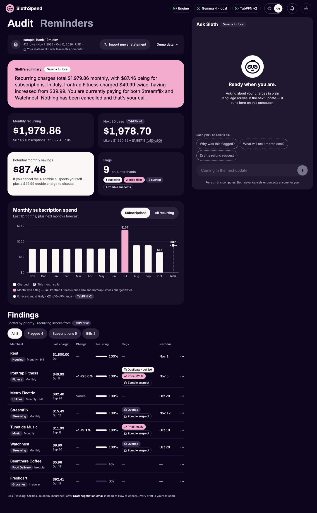 **Report** — summary, forecast with a range, burn chart and prioritised findings. | 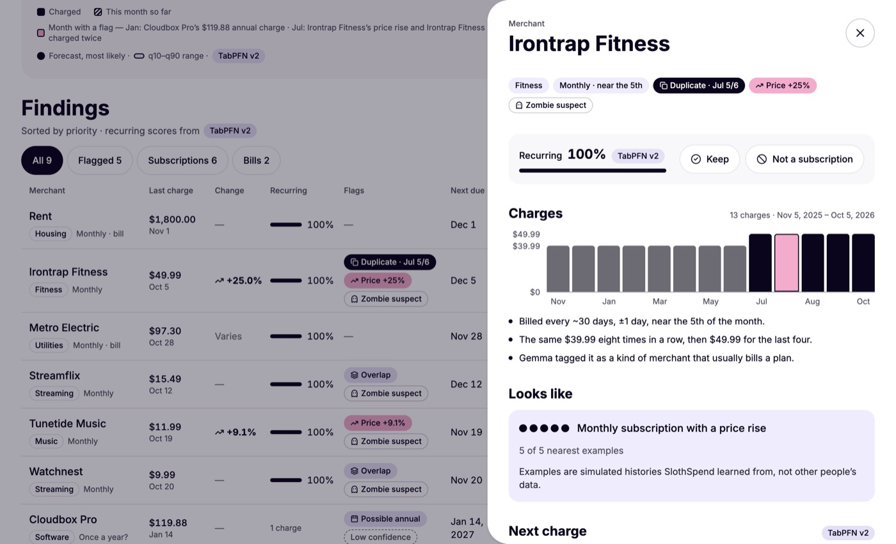 **Merchant drawer** — charges, reasons, "Looks like", next charge and flags. |
| 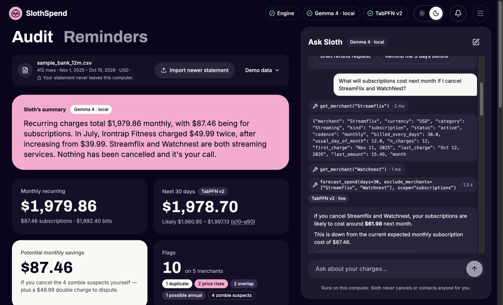 **What if I cancel?** — a live TabPFN forecast, with every tool call visible. | 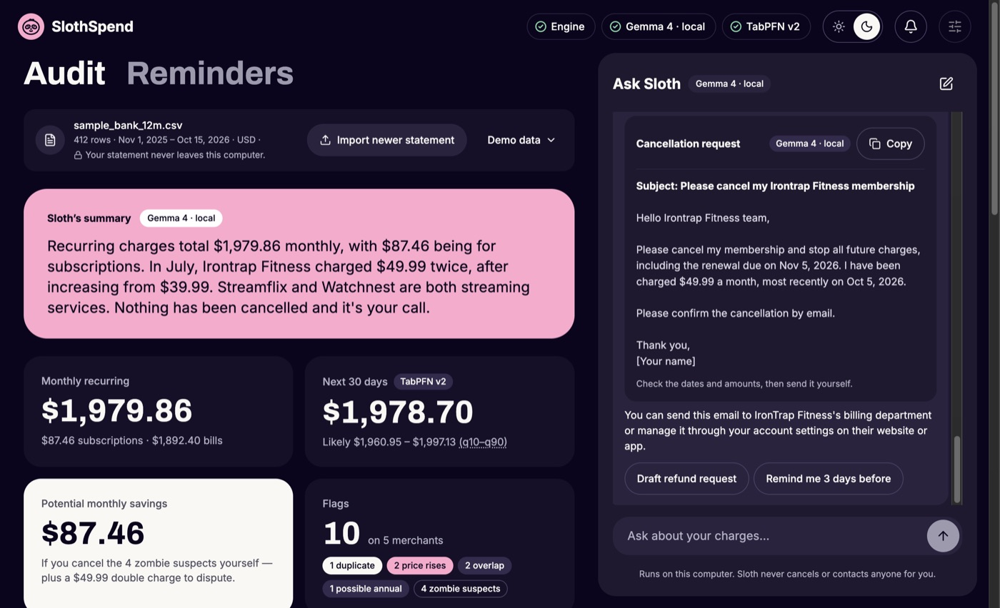 **"Cancel IronTrap for me"** — it explains it can't, offers a reminder, and drafts the request. |
| 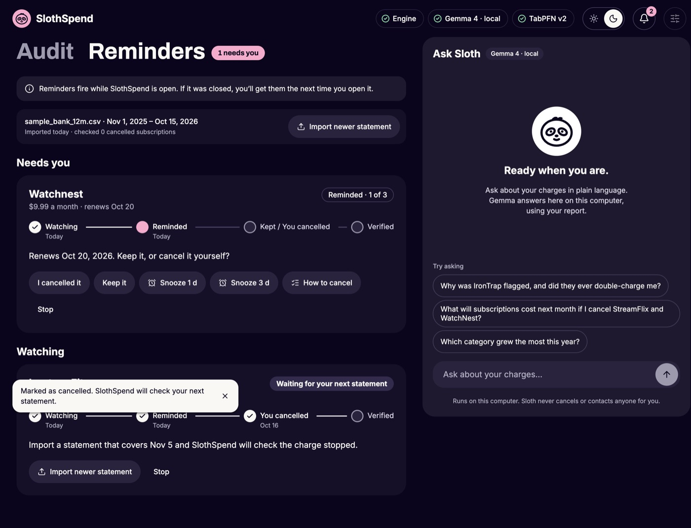 **Reminders** — needs you, watching, done; a 4-step progress stepper. | 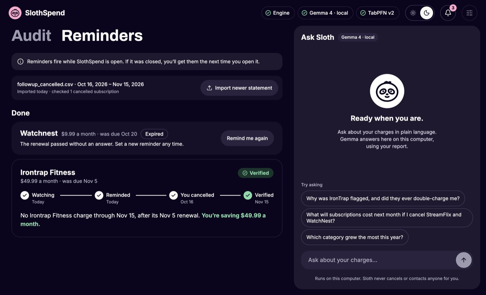 **Verified** — the next statement confirmed the charge stopped. |
| 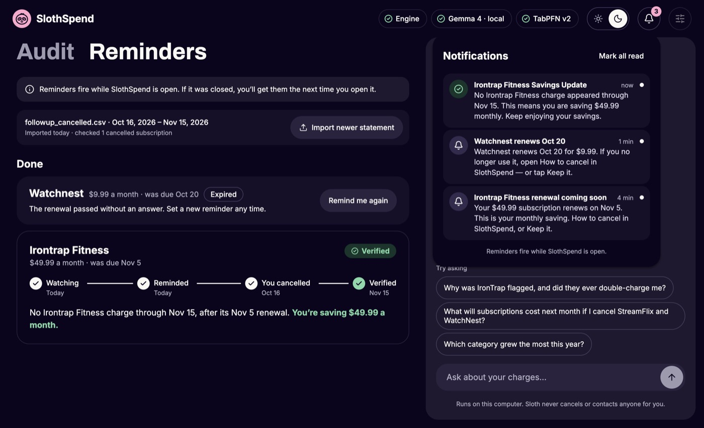 **Notifications** — inbox with unread state; OS notifications too. | 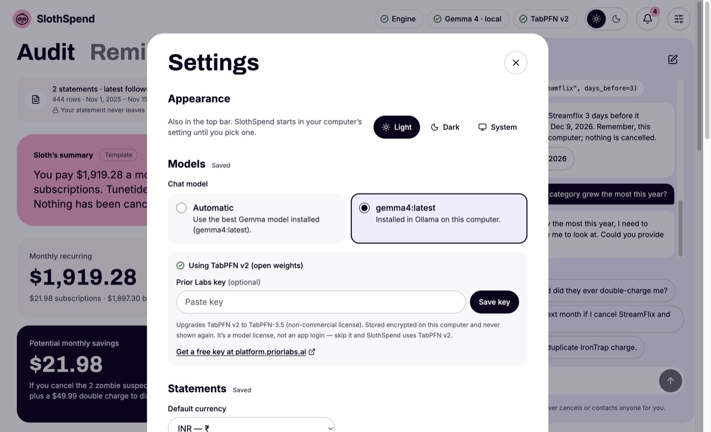 **Settings** — models, currency, reminders, demo mode, privacy. |

More: [boot](docs/screenshots/01-boot-setup.jpg) ·
[import](docs/screenshots/02-import.jpg) · [column mapper](docs/screenshots/03-column-mapper.jpg) ·
[audit progress](docs/screenshots/04-audit-progress.jpg) · [INR statement](docs/screenshots/06-report-inr.jpg) ·
[Ask Sloth](docs/screenshots/08-ask-sloth.jpg) · [negotiation email](docs/screenshots/11-negotiation-email.jpg) ·
[template fallback](docs/screenshots/12-template-fallback.jpg) · [delete data](docs/screenshots/18-delete-data.jpg) ·
[engine stopped](docs/screenshots/19-engine-stopped.jpg) · [website](docs/screenshots/20-website.jpg)

## Install

Download from the [latest release](https://github.com/souptik4572/sloth-spend/releases/latest):

| Platform | File |
|---|---|
| macOS 13+ (Apple Silicon) | `SlothSpend-0.1.0-mac-arm64.dmg` |
| Windows 10/11 (x64) | `SlothSpend-0.1.0-win-x64.exe` |

This is an unsigned hackathon build:

- **macOS:** drag SlothSpend to Applications, then right-click → **Open** the first time. If macOS says it
  can't be opened, run `xattr -cr /Applications/SlothSpend.app` once.
- **Windows:** SmartScreen may warn about an unknown publisher — choose **More info → Run anyway**.

## First run

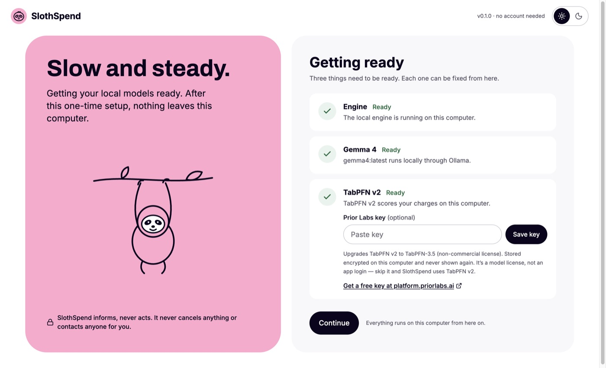

1. Install [Ollama](https://ollama.com/download) **0.20 or newer** and open it.
2. Any Gemma model you already have works. If you have none, SlothSpend offers to download `gemma4:e4b`
   (about 5 GB) with a progress bar.
3. **TabPFN v2** downloads automatically on first launch (about 70 MB, no account).
4. *Optional:* paste a free [Prior Labs](https://platform.priorlabs.ai) key to upgrade to **TabPFN-3.5**. It's a
   model licence, not an app login: accept the TabPFN-3.5 licence on your Prior Labs account first. The key is
   encrypted with the OS keychain and never shown again; remove it any time to go back to v2.

Want to look around first? **Demo data → Sample statement** loads 12 months of fictional charges.

## Using SlothSpend

### 1. Import a statement

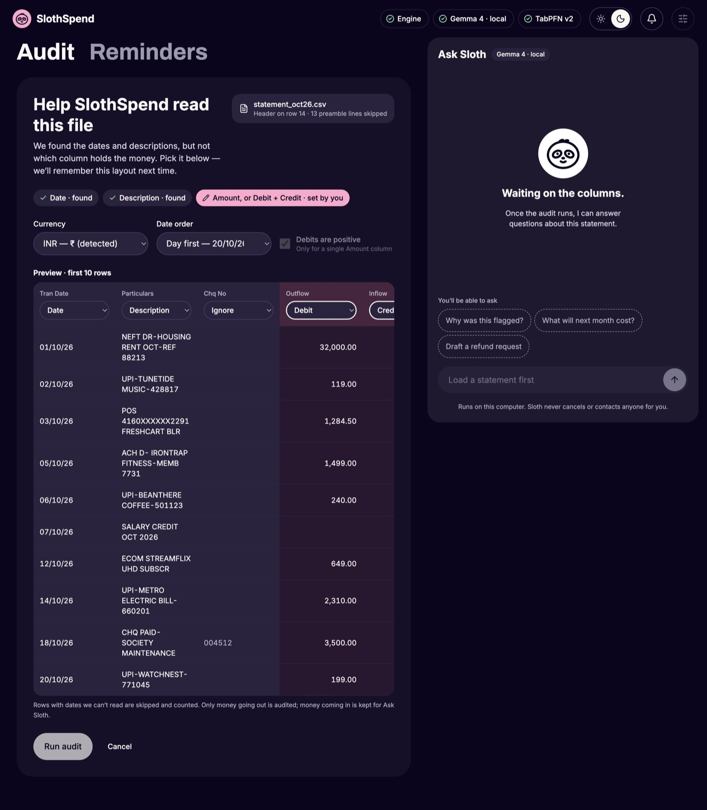

Drop a CSV on the Audit tab. Most exports are recognised automatically; otherwise the column mapper asks
which column holds the money and remembers the layout. The audit runs in nine visible stages, usually in
under a minute ([progress](docs/screenshots/04-audit-progress.jpg)).

### 2. Read the report

The pink card is Sloth's summary. Below it: monthly recurring, the next 30 days (TabPFN q10–q90),
potential savings, and flags; a 12-month burn chart with the forecast; and findings sorted by priority.
Correct the model with **Keep** / **Not a subscription** — TabPFN learns from it in context. Open any
merchant to rename it, see why it was flagged, or draft an email.

### 3. Ask Sloth

Try the suggested prompts:

- *Why was IronTrap flagged, and did they ever double-charge me?*
- *What will subscriptions cost next month if I cancel StreamFlix and WatchNest?*
- *Which category grew the most this year?*
- *Draft a refund request for the duplicate IronTrap charge.*
- *Remind me three days before IronTrap renews.*

| Tool | What it does |
|---|---|
| `get_report_overview` | Summary numbers and top findings |
| `get_merchant` | One merchant's cadence, charges, flags and forecast (fuzzy-matched) |
| `find_duplicate_charges` | Identical charges a few days apart |
| `spend_by_category` | Spend per category and month, with growth |
| `forecast_spend` | **Live TabPFN** forecast and "what if I cancel X" |
| `score_merchant` | **Live TabPFN** recurring score with your corrections |
| `run_readonly_sql` | One read-only `SELECT` (50 rows, 2 s budget) |
| `set_renewal_reminder` | Schedules a local reminder — nothing else |

### 4. Reminders and verification


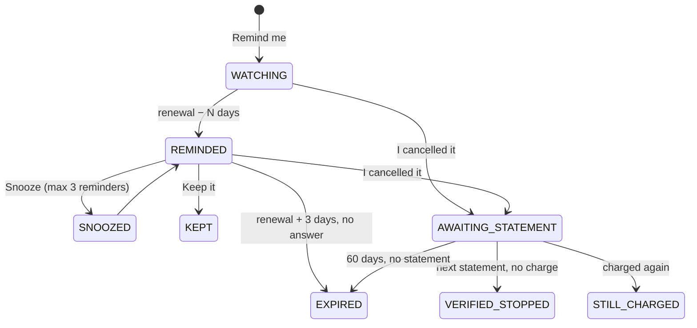

There is no workflow engine: reminders are rows in SQLite plus one loop that ticks at startup and every 30 s.
Each transition is compare-and-set, so a click and a tick can't overwrite each other. **Demo mode** (Settings)
compresses every wait to N seconds.

## Privacy: where your data goes

| Data | Goes to | When | Default |
|---|---|---|---|
| Transactions, merchants, amounts, chats, reminders | This computer — local SQLite | Always | — |
| Merchant descriptions → Gemma | This computer — Ollama on 127.0.0.1 | Import | On |
| Reminder and email facts → Gemma | This computer — Ollama on 127.0.0.1 | A reminder fires / a draft | On |
| TabPFN inputs | This computer — local PyTorch | Import and chat | On |
| TabPFN v2 weights | Internet, one time — Hugging Face | First run | Automatic |
| TabPFN-3.5 weights | Internet, one time — Prior Labs + Hugging Face | Only after you add a key | Off |
| Gemma weights | Internet, one time — Ollama registry | First run | You start it |
| Span timings, token counts, tool names (no prompts or answers) | Internet, opt-in — Sentry | Only if traces are on | Off |

`engine/tests/test_egress.py` runs the whole app — audit, every tool, chat, drafts, a reminder cycle and
*Delete all local data* — with every non-loopback socket connection refused, and fails on any attempt. If
`OLLAMA_HOST` points at another computer, the app warns you that Gemma's inputs leave this one.

## Architecture

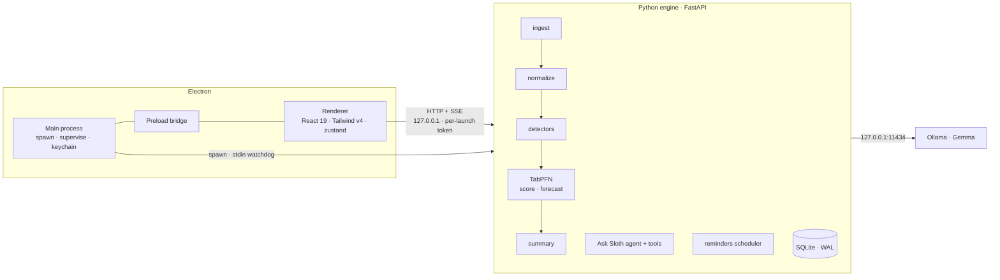

- **Electron main** picks a free port, generates a per-launch token, spawns the engine (PyInstaller onedir in
  packaged builds), and keeps the Prior Labs key in the OS keychain (`safeStorage`). If Electron dies, the
  engine sees stdin close and exits.
- **Renderer** talks to the engine only over loopback HTTP and server-sent events.
- **Engine** (`engine/app`): `ingest`, `normalize`, `features`, `detectors`, `tabular` (TabPFN version ladder:
  v2 by default, 3.5 with a key), `report` (the pipeline), `agent` + `tools` (Ask Sloth), `drafts`,
  `reminders` + `notes`, `guard` (no links/phones/false claims), `db`.

| Layer | Stack |
|---|---|
| Desktop shell | Electron 44, electron-vite, electron-builder |
| UI | React 19, TypeScript, Tailwind CSS v4, zustand, lucide-react, react-markdown |
| Engine | Python 3.11, FastAPI, uvicorn, sse-starlette, pandas, SQLite |
| Models | TabPFN 9.2 (v2 weights; 3.5 optional), Gemma via Ollama (`ollama` client) |
| Packaging | PyInstaller onedir, electron-builder (dmg, NSIS), GitHub Actions |

## Performance

Packaged macOS build, Apple Silicon, TabPFN v2, `gemma4:latest` (2026-10-22):

| Check | Budget | Measured |
|---|---|---|
| Launch → window shown | — | 0.18 s |
| Launch → engine healthy | ≤ 20 s | 7.1 s with a saved key · ~0.1 s spawn without |
| Sample audit (412 rows, 12 months) | ≤ 60 s | 27.7 s |
| Re-score after a correction | ≤ 5 s | 2.4 s |
| `/health` p95 during an audit | < 50 ms | 19 ms |
| Quit → engine gone · force-kill → engine gone | — | 0.13 s · 0.02 s |

Windows (CPU budget ≤ 120 s) and TabPFN-3.5 timings are pending — see
[`docs/dod-results.md`](docs/dod-results.md).

## Development

**Prerequisites:** Node 24, Python 3.11, [uv](https://docs.astral.sh/uv/), Ollama ≥ 0.20 with a Gemma model.

```bash
git clone https://github.com/souptik4572/sloth-spend.git
cd sloth-spend
npm install
npm run engine:venv     # engine/.venv from engine/requirements.lock (+ dev tools)
npm run dev             # Electron + Vite; the engine runs from engine/.venv
```

| Script | Does |
|---|---|
| `npm run dev` | Run the app with hot reload |
| `npm test` | Renderer tests (Vitest) |
| `npm run engine:test` | Engine tests (pytest), including `test_egress.py` |
| `npm run lint` · `npm run typecheck` | ESLint + Prettier · TypeScript |
| `npm run engine:build` | PyInstaller onedir → `engine/dist/slothspend-engine` |
| `npm run engine:smoke` | Start the frozen engine and check `/health` |
| `npm run dist:mac` · `npm run dist:win` | Package (run on the matching OS) |

Engine dependencies are pinned in `engine/requirements.lock` (regenerate instructions at its top); Node
dependencies in `package-lock.json`. CI (`.github/workflows/ci.yml`) runs typecheck, lint and both test suites
on every push; pushing a tag `v*` runs `release.yml`, which builds the dmg and exe on macOS and Windows runners
and publishes a GitHub Release.

### Project structure

```
sloth-spend/
├── src/
│   ├── main/            # Electron main: lifecycle, engine sidecar, keychain-backed prefs
│   ├── preload/         # the renderer ⇄ main bridge (window.sloth)
│   └── renderer/src/    # React app: screens, components, stores, lib (api, chat, reminders…)
├── engine/
│   ├── app/             # FastAPI engine (pipeline, models, agent, reminders, API routes)
│   ├── app/data/        # sample statements and simulated priors
│   ├── tests/           # pytest suite (+ fixtures)
│   ├── scripts/         # sample-data and priors generators, smoke test
│   └── slothspend_engine.spec   # PyInstaller build
├── site/                # slothspend.tech landing page (single static file)
├── docs/                # DoD results and screenshots
├── resources/ build/ design/    # icons and brand assets
└── IMPL.md · sloth-spend-spec.md  # implementation plan and product spec
```

## Configuration

User settings (currency, chat model, reminder days, demo mode) live in the app's SQLite `settings` table and
are edited in **Settings**. Environment variables:

| Variable | Set by | Purpose |
|---|---|---|
| `OLLAMA_HOST` | you (default `http://127.0.0.1:11434`) | Where Ollama runs; the app warns if it isn't loopback |
| `SLOTH_CHAT_MODEL` | you (optional) | Force a chat model instead of the best installed Gemma |
| `SLOTH_PYTHON` | dev | Interpreter for `npm run dev` |
| `SLOTH_PORT`, `SLOTH_TOKEN`, `SLOTH_DATA_DIR` | Electron main | Engine bind address, auth token, data folder |
| `TABPFN_TOKEN`, `TABPFN_MODEL_CACHE_DIR` | Electron main | Prior Labs key (from the keychain), weight cache |
| `SLOTH_TELEMETRY` | Electron main (from Settings) | Opt-in traces |
| `SLOTH_NO_WATCHDOG`, `SLOTH_DISABLE_TABPFN` | dev / CI | Manual engine runs; heuristic scorer in tests |

Data lives in the OS app-data folder (`~/Library/Application Support/SlothSpend` on macOS,
`%APPDATA%\SlothSpend` on Windows).

## Engine API

All routes need the per-launch `X-Sloth-Token` header and listen on 127.0.0.1 only. A Postman collection is in
`engine/postman/`.

| Area | Routes |
|---|---|
| Health & setup | `GET /health` · `POST /setup/ollama/pull` (SSE) |
| Import & report | `POST /import` · `DELETE /import/{id}` · `POST /import/{id}/confirm` (SSE) · `POST /demo/load-sample` (SSE) · `GET /report` · `POST /report/rescore` |
| Merchants | `GET /series/{id}` · `POST /series/{id}/label` · `PATCH /series/{id}/merchant` · `PATCH /merchant-map/{key}` · `POST /series/{id}/draft` (SSE) |
| Ask Sloth | `POST /chat` (SSE) · `GET /chat/{conversation_id}` |
| Reminders | `GET /reminders` · `POST /reminders` · `POST /reminders/{id}/keep · /snooze · /stop · /cancelled` |
| Notifications | `GET /notifications?since_id=` · `?all=1` · `POST /notifications/{id}/read` · `POST /notifications/read-all` |
| Settings & data | `GET/PUT /settings` · `DELETE /data` · `POST /shutdown` |

## Troubleshooting

| Symptom | Fix |
|---|---|
| Gemma pill says *Ollama not found* | Install or open Ollama; the pill turns green by itself. |
| *Update Ollama* | Gemma 4 tool calling needs Ollama 0.20 or newer. |
| TabPFN-3.5 upgrade failed | Accept the TabPFN-3.5 licence on your Prior Labs account, then **Try again** in Settings. SlothSpend keeps using v2 meanwhile. |
| *The local engine stopped* | Click **Restart engine**; the dialog shows the last log lines. Your data is safe in SQLite. |
| Text marked *Template* / scores marked *Heuristic* | Gemma or TabPFN wasn't available; results are still complete, just simpler. |
| macOS says the app is damaged | `xattr -cr /Applications/SlothSpend.app` (unsigned build). |

## Roadmap

- Clean-machine Definition of Done runs on macOS and Windows ([status](docs/dod-results.md))
- Open at login, so reminders fire on time even when the app is closed
- Sentry agent tracing (opt-in), signed and notarized builds

## Hacktoberfest notes

Built for Hacktoberfest 2026 (entry window Oct 19–25, 2026) around open AI models. **Commits after the
deadline:** none so far — any will be listed here.

## License and attribution

- **SlothSpend:** MIT — see [LICENSE](LICENSE).
- **TabPFN v2 weights:** Prior Labs License 1.1 (Apache 2.0 with an attribution requirement). **Built with
  PriorLabs-TabPFN.**
- **TabPFN-3.5 weights:** downloaded only with your own Prior Labs key, under Prior Labs' non-commercial licence.
- **`tabpfn` Python package:** Apache 2.0, © Prior Labs GmbH.
- **Gemma:** downloaded by you through Ollama and used under Google's Gemma terms.
