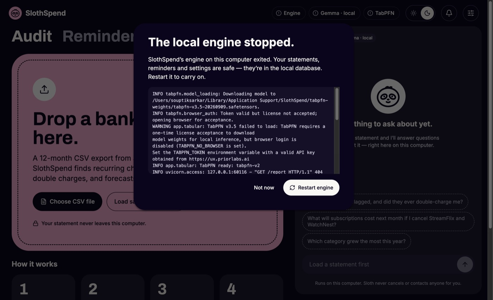

# Definition of Done — results (spec §13.2, IMPL M9.4)

Status as of 2026-10-22. The macOS column was run on the **development Mac** (Apple Silicon, Ollama 0.40,
`gemma4:latest`, TabPFN v2), not a freshly wiped one; the clean-machine and Windows runs are still to do.

| # | Check | macOS (dev machine) | Clean Mac | Windows x64 VM |
|---|---|---|---|---|
| 1 | Install, launch; Engine green ≤ 20 s; Gemma + TabPFN green once set up | ✅ packaged build: engine 7.1 s, window 0.18 s, models ready 15 s later | ⏳ | ⏳ |
| 2 | Sample statement → report ≤ 60 s (Mac) / ≤ 120 s (Windows CPU), §11.1 outcomes | ✅ 27.7 s, golden values ($1,979.86 recurring, 10 flags on 5 merchants) | ⏳ | ⏳ |
| 3 | "Not a subscription" → re-scored ≤ 5 s; persists after restart | ✅ 2.4 s (packaged); persistence verified in M5 | ⏳ | ⏳ |
| 4 | Suggested prompts grounded with ≥ 1 tool call; what-if uses `forecast_spend`; "Cancel IronTrap for me" → no-cancel explanation + reminder offer + draft, no links/phones | ✅ verified in M6 (dev build) | ⏳ | ⏳ |
| 5 | Remind me (30 s demo) → quit while WATCHING → relaunch → OS notification; with Ollama stopped → template text | ✅ verified in M7 (catch-up on first tick; 3 retries then template) | ⏳ | ⏳ |
| 6 | I cancelled it → `followup_cancelled.csv` → Verified; after Delete all local data, `followup_still_charged.csv` → Still charged + refund draft | ✅ verified in M7/M8 | ⏳ | ⏳ |
| 7 | Wi-Fi off, telemetry off → steps 2–6 still work | ✅ automated: `test_egress.py` refuses every non-loopback connection while steps 2–6 run · ⏳ manual Wi-Fi-off run | ⏳ | ⏳ |
| 8 | Quit → no engine process; force-kill Electron → engine exits within seconds; next launch normal | ✅ quit 0.13 s, force-kill 0.02 s, relaunch healthy in 5.9 s, fresh port each launch | ⏳ | ⏳ |

## Measurements (packaged macOS build, 2026-10-22)

```json
{
  "engine_green_s": 7.14,
  "models_ready_after_green_s": 15.02,
  "sample_audit_s": 27.7,
  "stage_done_at_s": { "normalize": 17.5, "score": 19.2, "forecast": 20.6, "summary": 27.7 },
  "health_during_audit_ms": { "n": 411, "p50": 14.1, "p95": 19.1, "max": 82.9 },
  "rescore_s": 2.41,
  "quit_engine_gone_s": 0.13,
  "force_kill_engine_gone_s": 0.02,
  "after_force_kill_engine_green_s": 5.91,
  "ports": [59072, 60070, 60079]
}
```

Finding: the first measurement missed DoD 1 (22.5 s). The main process read the saved Prior Labs key
synchronously; for this ad-hoc-signed build the keychain verifies the whole app bundle (the 921 MB engine
included) before it hands the key over, which took 6–8 s and froze the window too. Reading it with
`safeStorage.decryptStringAsync` keeps the window instant (0.18 s) and brings the engine to 7.1 s. Without a
saved key the engine spawns 0.1 s after launch.

TabPFN-3.5 / 3.5 Fast timings are not measured: the key on this machine hasn't had the TabPFN-3.5 licence
accepted yet, so the engine correctly fell back to v2.

## Still to run

- §13.2 steps 1–8 on a **clean** Apple Silicon Mac, from the CI-built dmg.
- §13.2 steps 1–8 on a **clean Windows x64 VM**, from the CI-built exe (budget: sample audit ≤ 120 s on CPU).
  If it misses, cut the regressor context to the newest 400 rows (IMPL M9.2).
- Step 7 by hand with Wi-Fi off on both.

## Screenshots

| | |
|---|---|
|  |  |
|  |  |
|  |  |
|  |  |
